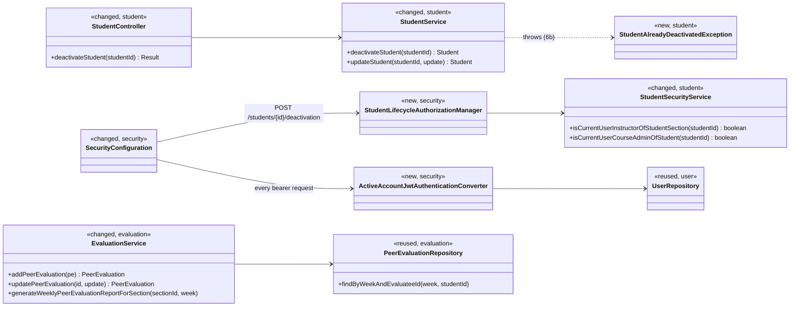
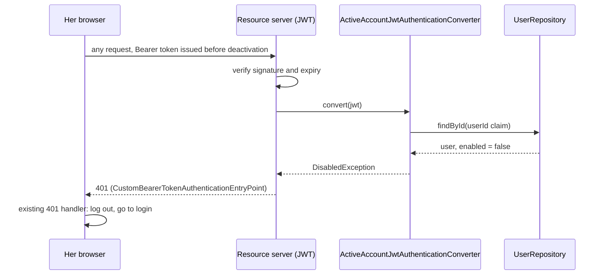

# Students (STU) Design

> Realizes: UC-STU-deactivate-student
> Depends on: FR-SEC-active-account, FR-SEC-deny-unauthorized, BR-student-lifecycle, BR-deactivated-evaluatee, BR-submission-owed, BR-section-scoped-access, BR-role-based-access
> See: [use cases](../requirements/use-cases.md#student), [SRS security FRs](../requirements/software-requirements-specification.md#security-and-authorization-requirements), [architectural-design.md](architectural-design.md#shared-foundation-components) (shared foundation component view, Crosscutting Concepts)
> Designed against `main` at `59f0267` (2026-11-06).

## Overview

The `student` slice holds a student's account. Before this design, deactivating one was the generic `PUT /students/{studentId}` flipping `enabled` from the edit form's Status dropdown: no warning, no check that the caller is the student's instructor or course admin, and nothing for the rest of the system to act on. A deactivated student also kept her access for the life of her token (up to 2 hours), and her teammates could still submit peer evaluations of her.

This design adds a dedicated deactivation route with its own authorization manager, makes every authenticated request check that the account is still active, and makes `evaluation` refuse evaluations of a deactivated student and drop her from the course section's report for weeks with nothing to show. She stays on her team (BR-student-lifecycle), so nothing in `team` or `activity` changes.

## Components & classes



Files: [StudentController](../../backend/src/main/java/team/projectpulse/student/StudentController.java), [StudentService](../../backend/src/main/java/team/projectpulse/student/StudentService.java), [StudentSecurityService](../../backend/src/main/java/team/projectpulse/student/StudentSecurityService.java), [SecurityConfiguration](../../backend/src/main/java/team/projectpulse/security/SecurityConfiguration.java), [EvaluationService](../../backend/src/main/java/team/projectpulse/evaluation/EvaluationService.java), new `security/authorizationmanagers/StudentLifecycleAuthorizationManager.java` and `security/ActiveAccountJwtAuthenticationConverter.java`.

Frontend: `apis/student` gains `deactivateStudent(id)`; [Students.vue](../../frontend/src/pages/students/Students.vue) gains a Deactivate button in the Operations column, shown only for an enabled student; [EditStudentForm.vue](../../frontend/src/pages/students/EditStudentForm.vue) disables the Status dropdown for an enabled student, so it can only reactivate; [SubmitTeamsEvaluations.vue](../../frontend/src/pages/evaluations/SubmitTeamsEvaluations.vue) leaves deactivated teammates out of the list to evaluate.

## Sequence

### UC-STU-deactivate-student: deactivate a student

```mermaid
sequenceDiagram
    actor I as Course admin / instructor
    participant UI as Students.vue
    participant SC as SecurityConfiguration
    participant AM as StudentLifecycleAuthorizationManager
    participant C as StudentController
    participant S as StudentService
    I->>UI: 1-3 Deactivate, on an active student's row
    UI->>I: 4 warning: the consequences in the use case's Associated Information; Confirm / Cancel
    Note over UI: 5a Cancel: no request; back to the list
    I->>UI: 5 Confirm
    UI->>SC: POST /api/v1/students/{studentId}/deactivation
    SC->>AM: authorize(studentId)
    Note over AM: instructor assigned to her course section, or course admin of her course?<br/>6a no, or unknown id: 403, nothing changes
    AM-->>SC: granted
    SC->>C: deactivateStudent(studentId)
    C->>S: deactivateStudent(studentId)
    Note over S: 6b already deactivated: 409, nothing changes
    S->>S: enabled = false; team, activities, evaluations untouched
    S-->>C: Student
    C-->>UI: 200 Result + StudentDto
    UI->>I: 6 "<name> has been deactivated"; reload the list
```

### Her next request (FR-SEC-active-account)



## API contract

| Endpoint | Caller (who may) | Request | Success | Errors, by extension |
|---|---|---|---|---|
| `POST /api/v1/students/{studentId}/deactivation` | An instructor assigned to the student's course section, or the course admin who owns its course (BR-student-lifecycle, BR-section-scoped-access, BR-role-based-access): `StudentLifecycleAuthorizationManager`; route rule added before the `denyAll()` catch-all | No body | `200`, `Result` with the `StudentDto` (`enabled: false`) | 6a (anyone else, including the student herself): `403`, `Result` envelope, nothing changes. Unknown `studentId`: `403` (fails closed, as the other managers do). 6b: `409`, message "This student is already deactivated." |
| `PUT /api/v1/students/{studentId}` (changed) | Unchanged | `enabled: false` for an enabled student is ignored; `enabled: true` for a disabled student still reactivates her | `200` | Unchanged |
| `POST /api/v1/evaluations`, `PUT /api/v1/evaluations/{evaluationId}` (changed) | Unchanged | Evaluatee deactivated (BR-deactivated-evaluatee) | — | `400`, message naming the condition, as BR-team-assignment-required's refusals do |
| Every bearer-authenticated request (changed) | — | Token of a user whose account is now deactivated, student or instructor | — | `401` |

## Key decisions

**Check the account on every request, in the JWT authentication converter.** FR-SEC-active-account denies access "regardless of otherwise-valid credentials", and the token is one. The converter wraps the existing `jwtAuthenticationConverter()` and looks the user up by the `userId` claim. Cost: one primary-key read per request. Rejected: a shorter token lifetime, which narrows the window but keeps it. Rejected: a token denylist, which is new state to store and expire. This is the trunk: it touches every authenticated route, for instructors as well as students.

**She stays on her team; the refusal keys on `enabled`, not on the team.** Rejected: setting `team` to null on deactivation, which would make `addPeerEvaluation`'s team check refuse evaluations of her for free, but would also drop her history from the course section's report, which lists only students on a team, and contradict BR-student-lifecycle.

**The report keeps a deactivated student only for a week in which she received an evaluation** (BR-deactivated-evaluatee). The filter is `team != null && (enabled || evaluations of her that week exist)`, using `PeerEvaluationRepository.findByWeekAndEvaluateeId`. Rejected: a `deactivated_at` column, which would need a migration and a history for a student deactivated, reactivated and deactivated again.

**A dedicated route with its own authorization manager.** Rejected: reusing `PUT /students/{studentId}` under `UserOwnershipAuthorizationManager`, which admits the student herself and refuses a course admin who owns the course but is not assigned to the course section. That refusal contradicts BR-student-lifecycle; the reminder routes already compose "assigned instructor or owning course admin" the same way.

**The edit form can only reactivate.** `updateStudent` may set `enabled` from false to true, never from true to false. Rejected: removing the field, which leaves no way to reactivate until UC-STU-reactivate-student is built. Rejected: leaving it, which keeps a second deactivation path that skips step 4's warning and 6a/6b.

**6b is a `409`, not a silent `200`.** Rejected: an idempotent success, which would tell the second instructor she had just deactivated the student when someone else had.

## Data model

No change. Deactivation uses the existing `enabled` column on the user table (SRS Business Domain Model).

## Reuse & cross-cutting

- Authorization: `StudentSecurityService.isCurrentUserInstructorOfStudentSection` (reused); `isCurrentUserCourseAdminOfStudent` mirrors `SectionSecurityService.isSectionOwner`. Like every check in that class, it fails closed on a missing row.
- Error envelope: `StudentAlreadyDeactivatedException` maps to `409` in `ExceptionHandlerAdvice`; `PeerEvaluationIllegalArgumentException` keeps its existing `400` mapping.
- Frontend: the shared Axios instance already logs the user out on `401`, so the session check needs no frontend code. The warning uses Element Plus `ElMessageBox.confirm`.
- BR-submission-owed: `SubmissionStatusService.findOwedItems` already skips a deactivated student and counts only active teammates. Unchanged.

## Tests

| Use case, flow | Level | Asserts |
|---|---|---|
| T1 main, assigned instructor | integration | `200`; she is disabled; her team, her activity count, and the count of evaluations she gave and received are unchanged |
| T2 main, course admin not assigned to the course section | integration | `200` (BR-student-lifecycle, BR-role-based-access) |
| T3 6a, instructor of another course section | integration | `403` with the `Result` envelope; she is still enabled |
| T4 6a, a student (herself, and a teammate) | integration | `403`; she is still enabled |
| T5 6b, already deactivated | integration | `409` with the already-deactivated message; she is still disabled |
| T6 session in progress (FR-SEC-active-account) | integration | Her token issued before deactivation: the next `GET` returns `401`; an active student's token: `200`; a deactivated instructor's token: `401` |
| T7 BR-deactivated-evaluatee, submit | integration | `POST /evaluations` of a deactivated teammate: `400`; of an active teammate in the same request setup: `200` |
| T8 BR-deactivated-evaluatee, update | unit | Updating an existing evaluation of a now-deactivated teammate is refused |
| T9 BR-deactivated-evaluatee, report | unit | Deactivated, evaluated in week W: listed for W; not evaluated in week W+1: not listed for W+1; an active student with no evaluations: listed |
| T10 edit form cannot deactivate | unit | `updateStudent` with `enabled: false` on an enabled student leaves her enabled; `enabled: true` on a disabled student enables her |
| T11 unknown student | integration | `POST /students/{unknownId}/deactivation`: `403`; nothing changes |
| T12 step 4, 5a, choice offered | E2E (Cypress, API stubbed) | The warning names the consequences; Cancel sends no `POST`; a deactivated student's row has no Deactivate button; Confirm sends one `POST` and shows the success message |
| BR-submission-owed | existing | `SubmissionStatusServiceTest` already covers a deactivated student; cited, no new test |

## Open questions / risks

- **The converter's exception path.** A `DisabledException` thrown from the JWT converter must reach `CustomBearerTokenAuthenticationEntryPoint` as a `401`, not escape as a `500`. T6 is the proof; if it does not, the check moves to a filter after bearer authentication.
- **One more database read per request.** Accepted (see Key decisions). Not measured.
- **Reactivation stays on the edit form** until UC-STU-reactivate-student is built; its warning and extensions are that use case's to design.
- **The section report route** is guarded by `SectionInstructorAuthorizationManager` alone, so a course admin not assigned to the course section is still denied there (recorded in [not.md](not.md)). This design does not change that route.
